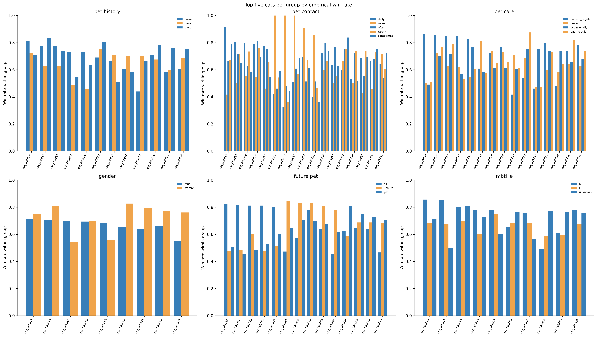

# Human Preference Differences

## Data and coverage

The analysis uses 21,893 between-cat response records from `data/processed/train_clean.csv`. `pet_history` is the primary grouping variable; `pet_contact` and `pet_care` are analyzed next, followed by `gender`, `future_pet`, and `mbti_ie`. The dictionary’s `unknown` value for `mbti_ie` is retained as an observed category. Missing values are excluded only from the corresponding grouped analysis. No participant identifier is available, so counts are response records, not people.

| Variable | Group | Response records | Cat pairs | Cats |
|---|---|---:|---:|---:|
| pet_history | current | 7,512 | 4,976 | 237 |
| pet_history | never | 8,259 | 5,236 | 237 |
| pet_history | past | 5,663 | 4,156 | 237 |
| pet_contact | daily | 4,441 | 3,521 | 237 |
| pet_contact | never | 924 | 879 | 237 |
| pet_contact | often | 4,306 | 3,435 | 237 |
| pet_contact | rarely | 6,688 | 4,655 | 237 |
| pet_contact | sometimes | 5,075 | 3,883 | 237 |
| pet_care | current_regular | 3,200 | 2,735 | 237 |
| pet_care | never | 6,207 | 4,441 | 237 |
| pet_care | occasionally | 5,759 | 4,210 | 237 |
| pet_care | past_regular | 6,268 | 4,505 | 237 |
| gender | man | 12,298 | 6,227 | 237 |
| gender | woman | 9,136 | 5,561 | 237 |
| future_pet | no | 2,078 | 1,879 | 237 |
| future_pet | unsure | 4,314 | 3,431 | 237 |
| future_pet | yes | 15,042 | 6,625 | 237 |
| mbti_ie | E | 5,535 | 4,087 | 237 |
| mbti_ie | I | 12,329 | 6,276 | 237 |
| mbti_ie | unknown | 3,570 | 2,983 | 237 |

## Marginal A/B position choices

This table shows the A-side share and a 95% Wilson interval. These marginal side shares are distinct from preference for particular cat identities. The intervals assume independent response records and do not account for unobserved participant clustering.

| Variable | Group | Responses | Choose A | Choose B | A share | Wilson 95% CI |
|---|---|---:|---:|---:|---:|---:|
| pet_history | current | 7,512 | 3,705 | 3,807 | 0.493 | [0.482, 0.505] |
| pet_history | never | 8,259 | 4,385 | 3,874 | 0.531 | [0.520, 0.542] |
| pet_history | past | 5,663 | 3,010 | 2,653 | 0.532 | [0.519, 0.544] |
| pet_contact | daily | 4,441 | 2,334 | 2,107 | 0.526 | [0.511, 0.540] |
| pet_contact | never | 924 | 477 | 447 | 0.516 | [0.484, 0.548] |
| pet_contact | often | 4,306 | 2,191 | 2,115 | 0.509 | [0.494, 0.524] |
| pet_contact | rarely | 6,688 | 3,520 | 3,168 | 0.526 | [0.514, 0.538] |
| pet_contact | sometimes | 5,075 | 2,578 | 2,497 | 0.508 | [0.494, 0.522] |
| pet_care | current_regular | 3,200 | 1,654 | 1,546 | 0.517 | [0.500, 0.534] |
| pet_care | never | 6,207 | 3,299 | 2,908 | 0.531 | [0.519, 0.544] |
| pet_care | occasionally | 5,759 | 2,881 | 2,878 | 0.500 | [0.487, 0.513] |
| pet_care | past_regular | 6,268 | 3,266 | 3,002 | 0.521 | [0.509, 0.533] |
| gender | man | 12,298 | 6,330 | 5,968 | 0.515 | [0.506, 0.524] |
| gender | woman | 9,136 | 4,770 | 4,366 | 0.522 | [0.512, 0.532] |
| future_pet | no | 2,078 | 1,000 | 1,078 | 0.481 | [0.460, 0.503] |
| future_pet | unsure | 4,314 | 2,145 | 2,169 | 0.497 | [0.482, 0.512] |
| future_pet | yes | 15,042 | 7,955 | 7,087 | 0.529 | [0.521, 0.537] |
| mbti_ie | E | 5,535 | 3,040 | 2,495 | 0.549 | [0.536, 0.562] |
| mbti_ie | I | 12,329 | 6,147 | 6,182 | 0.499 | [0.490, 0.507] |
| mbti_ie | unknown | 3,570 | 1,913 | 1,657 | 0.536 | [0.519, 0.552] |

Missing values in the full training table: `pet_history` 508/24,896; `pet_contact` 508/24,896; `pet_care` 508/24,896; `gender` 508/24,896; `future_pet` 508/24,896; `mbti_ie` 508/24,896.

## Cat preference rankings

For each group, cats are ranked by empirical win rate over between-cat response records. This compares the cats chosen within each group and goes beyond the overall A/B position share. All observed groups cover the same 237 cats. The chart shows each group’s top five (the union of these cats per panel); complete rankings are in `outputs/human_preferences/tables/cat_rankings_by_group.csv`.

| Variable | Group 1 | Group 2 | Cats ranked | Spearman rank correlation | Top-10 overlap |
|---|---|---|---:|---:|---:|
| pet_history | current | never | 237 | 0.525 | 2/10 |
| pet_history | current | past | 237 | 0.583 | 3/10 |
| pet_history | never | past | 237 | 0.605 | 3/10 |
| pet_contact | daily | never | 237 | 0.229 | 0/10 |
| pet_contact | daily | often | 237 | 0.502 | 3/10 |
| pet_contact | daily | rarely | 237 | 0.514 | 3/10 |
| pet_contact | daily | sometimes | 237 | 0.506 | 3/10 |
| pet_contact | never | often | 237 | 0.130 | 0/10 |
| pet_contact | never | rarely | 237 | 0.283 | 0/10 |
| pet_contact | never | sometimes | 237 | 0.287 | 1/10 |
| pet_contact | often | rarely | 237 | 0.522 | 4/10 |
| pet_contact | often | sometimes | 237 | 0.456 | 3/10 |
| pet_contact | rarely | sometimes | 237 | 0.529 | 4/10 |
| pet_care | current_regular | never | 237 | 0.394 | 2/10 |
| pet_care | current_regular | occasionally | 237 | 0.458 | 3/10 |
| pet_care | current_regular | past_regular | 237 | 0.450 | 4/10 |
| pet_care | never | occasionally | 237 | 0.494 | 1/10 |
| pet_care | never | past_regular | 237 | 0.530 | 2/10 |
| pet_care | occasionally | past_regular | 237 | 0.591 | 4/10 |
| gender | man | woman | 237 | 0.676 | 5/10 |
| future_pet | no | unsure | 237 | 0.365 | 1/10 |
| future_pet | no | yes | 237 | 0.371 | 1/10 |
| future_pet | unsure | yes | 237 | 0.667 | 4/10 |
| mbti_ie | E | I | 237 | 0.612 | 6/10 |
| mbti_ie | E | unknown | 237 | 0.499 | 3/10 |
| mbti_ie | I | unknown | 237 | 0.626 | 3/10 |

## Statistical tests

A cat-pair-stratified score chi-square test checks whether the probability of choosing the lexicographically first cat varies across groups, conditioning on unordered cat identity pair. This controls for different cat-pair exposure across groups and answers a different question from the marginal A/B position shares. P-values are asymptotic and Holm-adjusted across all six group variables. The data include cat IDs, image IDs, A/B side, choice, comparison type, and unique response-row IDs, but no participant ID; this record-level test cannot correct within-participant dependence, so p-values are exploratory rather than cluster-valid inference.

| Variable | Response records | Informative cat pairs | χ² | df | p | Holm-adjusted p |
|---|---:|---:|---:|---:|---:|---:|
| pet_history | 21,434 | 3,917 | 1.34 | 2 | 0.512 | 1 |
| pet_contact | 21,434 | 4,196 | 0.85 | 4 | 0.932 | 1 |
| pet_care | 21,434 | 4,145 | 4.50 | 3 | 0.212 | 1 |
| gender | 21,434 | 3,399 | 0.76 | 1 | 0.384 | 1 |
| future_pet | 21,434 | 2,986 | 0.65 | 2 | 0.724 | 1 |
| mbti_ie | 21,434 | 3,575 | 4.59 | 2 | 0.101 | 0.605 |

## Method assessment

The primary sample is 21,893 between-cat response records (21,434 with observed group attributes). Each observed group spans all 237 cats; pet-history groups contain 5,663–8,259 responses and 4,156–5,236 distinct cat pairs. A/B share alone cannot establish cat-identity preference differences. The stratified score test is an omnibus identity-sensitive association check, while per-cat win rates and rank correlations are descriptive. A basic Bradley–Terry model is suitable for overall ranking and is implemented in the companion module. We additionally fit separate pet-history BT models: all three group-specific directed win graphs are strongly connected (237 cats each), so the unregularized fits are identifiable. Scores are saved in `pet_history_group_bt_scores.csv`; these in-sample fits are exploratory and do not constitute a formal interaction test or validation. A joint pet-history × cat BT extension would need explicit regularization and nested evaluation. Participant-clustered logistic or conditional-logistic models are not supportable because participant IDs are absent. A multi-factor regression could confound correlated self-reported attributes. Test interactions one at a time with training-fold-only estimation and use the saved validation split only for evaluation; do not use full-data summaries as validation features.

## Interpretation and limits

The conditional tests assess within-cat-pair group association; the empirical rankings describe each group’s observed wins and remain sensitive to sampling noise and unequal comparison counts. None of the six tests provides evidence of a group difference after Holm adjustment in this dataset; this is not proof that preferences are identical. Treat the p-values as exploratory: participant IDs are absent, repeated responses and shared images/cats may be dependent, and the test cannot account for participant-level clustering. The analysis is observational and does not support causal claims. Do not interpret response records as independent people.

## Recommendation for member 5

The available analysis does not establish that any human variable improves prediction. Do not add variables to the final model based on full-data results alone. If member 5 evaluates a nested extension, `pet_history` is the best-supported first candidate for a pre-specified `pet_history × cat` term because it is the priority variable and has broad support. `pet_contact` and `pet_care` are secondary candidates with broad support; other variables need a specific rationale. Test extensions separately or with suitable regularization, fit derived features within training folds, and retain a term only if validation performance improves against the no-group baseline. Do not use these full-data rankings or p-values as validation features or tuning evidence. Preference ranks and winner-derived quantities must not enter as predictors.
