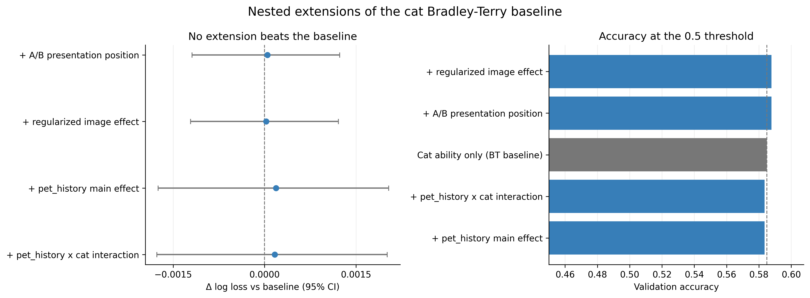
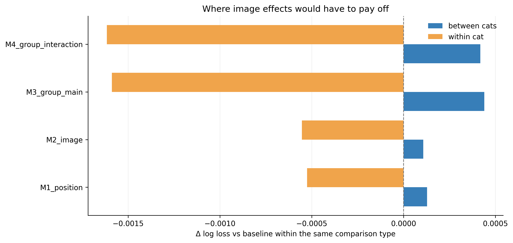
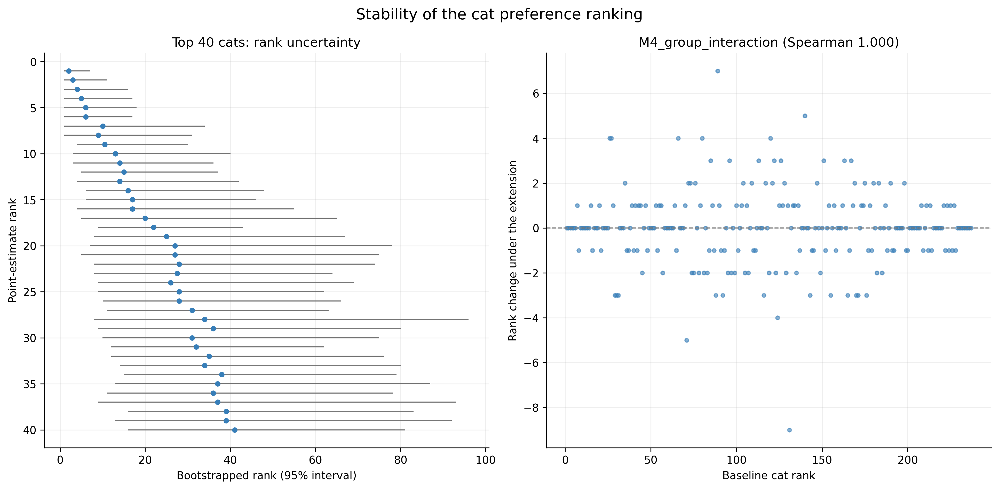

# 扩展模型、验证与排名稳健性

## 评估设计

本模块只使用共同划分 `data/splits/validation_split.csv`：训练 19,981 条回答记录、验证 4,915 条；每个无序图片对只属于一侧，没有图片对跨两个集合。所有猫分数、图片效应和人群交互项都只在训练部分拟合；以图片对为单位的 5 折内层交叉验证只用来选择惩罚强度；保存的验证集在候选模型全部定稿后一次性用于比较。全数据胜率、排名、检验统计量和已拟合全数据的分数都不进入预测。

没有参与者 ID，因此所有计数都是回答记录，不是独立人数；同一未知参与者可能贡献多条记录，下面的区间按图片对整簇重采样，只能部分吸收这种依赖。

## 模型阶梯

模型按“先控制干扰项，再按证据逐项加入”的顺序排列，不机械堆叠变量：

| 模型 | 加入项 | 加入依据 |
|---|---|---|
| M0 | 猫效应差值（BT 基线） | 成员 2 的基础模型，作为对照 |
| M1 | A/B 展示位置截距 | A/B 界面普遍存在位置偏差，不加会污染其他结论 |
| M2 | 猫内约束、带 L2 收缩的图片效应 | 成员 3：同猫图片一致率 53.05% 高于置换参照（p=0.0008） |
| M3 | `pet_history` 主效应 | 只检验人群整体 A 侧倾向，不等于猫咪偏好差异 |
| M4 | `pet_history` × 猫身份交互 | 成员 4 的优先候选，需要正则化；检验“不同人群偏好不同猫” |

## 内层惩罚选择

惩罚强度只在训练部分内部选择，验证集不参与：

| 模型 | 选中的惩罚 |
|---|---|
| M0_cat_baseline | 无（无收缩项） |
| M1_position | 无（无收缩项） |
| M2_image | {"image": 0.3} |
| M3_group_main | 无（无收缩项） |
| M4_group_interaction | {"image": 0.3, "group_cat": 1.0} |

各候选之间的内层 log loss 差距最大只有 0.00002（`M2_image`），说明惩罚强度的选择本身已经接近噪声水平：选中哪个收缩强度并不能证明它真的更好，这本身就是“扩展项没有稳定增益”的一个旁证。

## 验证集比较

所有模型都在同 4,915 条验证记录上评估；`Δ` 为相对 M0 的 log loss 变化（负值更好），区间按图片对整簇 bootstrap 得到。

| 模型 | 参数个数 | Log loss | Δ vs M0 [95% CI] | Brier | 准确率 | 显著优于 M0 |
|---|---:|---:|---:|---:|---:|---|
| M0_cat_baseline | 236 | 0.6689 | — | 0.2378 | 0.5849 | 否 |
| M1_position | 237 | 0.6690 | +0.00005 [-0.00119, +0.00123] | 0.2378 | 0.5878 | 否 |
| M2_image | 1,532 | 0.6689 | +0.00003 [-0.00121, +0.00121] | 0.2378 | 0.5878 | 否 |
| M3_group_main | 240 | 0.6691 | +0.00019 [-0.00175, +0.00204] | 0.2379 | 0.5835 | 否 |
| M4_group_interaction | 2,479 | 0.6691 | +0.00017 [-0.00177, +0.00201] | 0.2379 | 0.5835 | 否 |

位置项自身的估计是 +0.093（logit），相当于 A 侧被选概率 0.523，说明展示位置确实有系统优势。但猫分数只取决于猫与猫之间的差值，整体平移不改变排名；它只在 0.5 阈值分类上带来小幅准确率提升，log loss 几乎不变。

## 按比较类型拆分

同猫比较两侧猫身份相同，猫效应抵消，因此图片效应只可能在这一部分带来增益：

| 模型 | 类型 | 记录数 | Log loss | Brier | 准确率 |
|---|---|---:|---:|---:|---:|
| M0_cat_baseline | between_cats | 4,308 | 0.6655 | 0.2361 | 0.5945 |
| M0_cat_baseline | within_cat | 607 | 0.6931 | 0.2500 | 0.5173 |
| M1_position | between_cats | 4,308 | 0.6656 | 0.2362 | 0.5977 |
| M1_position | within_cat | 607 | 0.6926 | 0.2497 | 0.5173 |
| M2_image | between_cats | 4,308 | 0.6656 | 0.2362 | 0.5977 |
| M2_image | within_cat | 607 | 0.6926 | 0.2497 | 0.5173 |
| M3_group_main | between_cats | 4,308 | 0.6659 | 0.2363 | 0.5942 |
| M3_group_main | within_cat | 607 | 0.6916 | 0.2492 | 0.5074 |
| M4_group_interaction | between_cats | 4,308 | 0.6659 | 0.2363 | 0.5942 |
| M4_group_interaction | within_cat | 607 | 0.6915 | 0.2492 | 0.5074 |

图片效应项的取舍在两类记录上是相反的：M2 在 `within_cat` 记录上把 log loss 降低 0.0006，在 `between_cats` 记录上却升高 0.0001，两者几乎抵消。这与成员 3 的结论一致——同猫比较确实带有一点图片信息，但量级小到不足以改变整体预测，而图片项在异猫记录上只会增加方差。

## 猫咪排名稳定性

对基础模型按图片对整簇重采样 200 次重新拟合，每次记录每只猫的名次。重采样名次与点估计排名的 Spearman 相关中位数为 0.951（95% 区间 [0.936, 0.961]）；前十名重合率平均 0.73，最差一次 0.40。

把训练图片对随机分成两半各自独立拟合，两边排名的 Spearman 相关为 0.791，用 Spearman–Brown 公式外推到全量后为 0.883，两半的前十名重合 5/10。这是在缺少参与者 ID 时能给出的排名信度估计。

排名前 10 的猫及其名次区间：

| 猫 | 点估计名次 | Bootstrap 95% 区间 | 训练比较数 | 前十命中率 |
|---|---:|---|---:|---:|
| `cat_000024` | 1 | [1, 7] | 199 | 1.00 |
| `cat_000013` | 2 | [1, 11] | 191 | 0.95 |
| `cat_001013` | 3 | [1, 16] | 177 | 0.89 |
| `cat_000005` | 4 | [1, 17] | 156 | 0.87 |
| `cat_000015` | 5 | [1, 18] | 131 | 0.81 |
| `cat_000406` | 6 | [1, 17] | 183 | 0.83 |
| `cat_001697` | 7 | [1, 34] | 173 | 0.52 |
| `cat_000010` | 8 | [1, 31] | 179 | 0.64 |
| `cat_000018` | 9 | [4, 30] | 196 | 0.50 |
| `cat_000021` | 10 | [3, 40] | 183 | 0.34 |

## 模型设定之间的排名变化

同一份数据、不同模型设定下猫咪排名的相似度（与基础模型比较）：

| 模型 | 与基础模型的 Spearman | 前十重合 | 最大名次变化 |
|---|---:|---:|---:|
| M0_cat_baseline | 1.0000 | 10/10 | 0 |
| M1_position | 0.9999 | 10/10 | 4 |
| M2_image | 0.9999 | 10/10 | 4 |
| M3_group_main | 0.9997 | 10/10 | 9 |
| M4_group_interaction | 0.9997 | 10/10 | 9 |

## 结论

验证集上没有任何扩展模型把 log loss 相对基础模型显著降低；因此最终模型保留基础 Bradley–Terry，只报告猫的相对偏好。位置项、图片项和人群交互项作为稳健性检验保留在比较表里，不进入最终预测。

四个扩展模型的排名与基础模型的 Spearman 相关最低为 0.9997，前十名在每种设定下都完全相同；名次移动最多的是 `M4_group_interaction`，单只猫最多移动 9 名。也就是说，加入位置、图片或人群项会改变个别名次，但不会重排整个偏好结构——这与“猫的身份是主要信号，图片和人群只是次要调整”一致。

需要注意的是，即使排名相关接近 1，个别名次仍会移动数位，原因是相邻猫的分数非常接近；上文的 bootstrap 区间说明，这类相邻名次差异在没有更多比较记录时无法可靠区分。

## 局限

- 验证集只用于一次最终比较，但五个候选模型都在同一份验证集上排序；“最好模型”的区间没有做多重比较校正，最优模型的乐观偏差没有被消除。
- 按图片对重采样只处理了同一图片对内的重复回答；同一未知参与者跨图片对的依赖、猫与图片的共享都无法校正，区间实际可能偏窄。
- 训练集覆盖了验证集的全部图片和猫，所以这里的结论不涉及新图片、新猫或新参与者的泛化。若只用同猫训练记录估计图片效应，607 条同猫验证记录中只有 300 条两图都出现过。
- 人群交互项是在成员 4 未发现显著组间差异的前提下仍然拟合的探索项，其参数不应被解释为“某类人更喜欢某只猫”。

分析与报告生成由 AI 编程助手（DeepSeek Harness）协助完成；所有数字由脚本从清洗数据重新计算，可通过 `python scripts/run_model_comparison.py` 复现。
